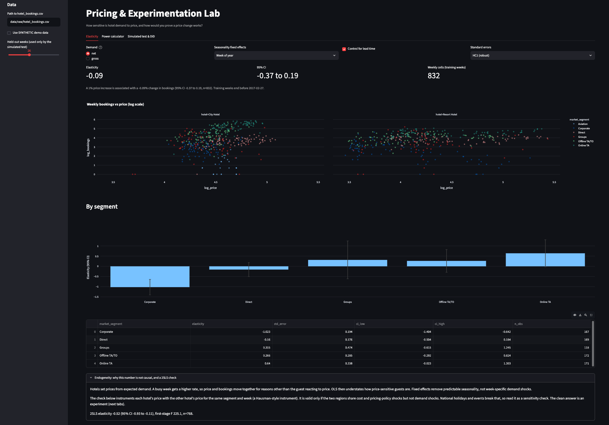
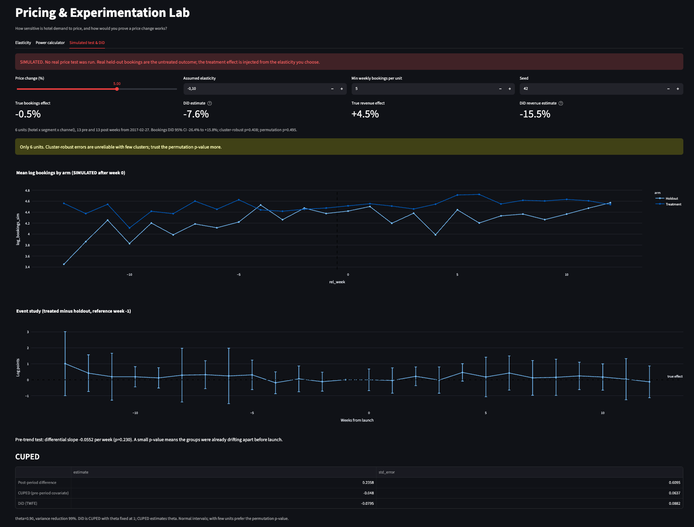

# Pricing & Experimentation Lab

Estimate how hotel demand responds to price, then design and analyse the
experiment that would prove a price change works.

[](https://github.com/Pinghsuanlin/pricing-experimentation-lab/actions/workflows/ci.yml)

## Why this project

Two questions sit behind most pricing decisions:

1. **How sensitive is demand to price?** If we raise prices 5%, how many
   bookings do we lose, and does revenue go up or down?
2. **How would we prove it?** Historical data can suggest an answer, but
   prices are set in response to demand, so the honest answer comes from a
   test. How big must the test be, what do we randomise, and how do we read it?

This repo answers both on a public hotel bookings dataset: an observational
elasticity with its caveats, a power calculator for planning a price test, and
a simulated price test analysed with difference-in-differences (DiD) and CUPED.

## What it shows

| Skill | Where |
|---|---|
| Causal inference and its limits (endogeneity, instruments) | `elasticity.py`, README "Design decisions" |
| Price elasticity with fixed effects and robust errors | `elasticity.py` |
| Experiment design: sample size, MDE vs duration, design effects | `power.py`, app tab 2 |
| Randomisation units, marketplace interference, switchbacks | app tab 2, README |
| DiD with a holdout, pre-trend test, event study, permutation inference | `did.py` |
| CUPED variance reduction | `cuped.py` |
| Simulation with a known answer to validate the analysis | `simulate.py`, `tests/` |
| Streamlit app, tested package, CI | `app.py`, `tests/`, `.github/workflows/ci.yml` |

## Architecture

```
 data/raw/hotel_bookings.csv          (not shipped; see data/README.md)
            |
            v
 data.py      load -> derive dates -> clean -> aggregate (hotel x segment x week)
            |                                      net or gross demand
            v
 simulate.holdout_cutoff   splits weeks into  [ training weeks | held-out weeks ]
            |                                          |               |
            v                                          v               v
 elasticity.py   log-log OLS + FE + robust SEs   on training weeks     |
                 per-segment fits, 2SLS check                          |
            |                                                          |
            | elasticity (or an assumed value)                         |
            v                                                          v
 simulate.py     SIMULATED test: random matched pairs of units, price change
                 injected in treated units after launch, controls untouched
            |
            v
 did.py          TWFE DiD, 2x2 DiD, pre-trend test, event study, permutation p
 cuped.py        CUPED-adjusted difference in means
            |
            v
 analyse.py  -> reports/results.md, results.json, simulated_panel.csv
 app.py      -> Streamlit: Elasticity | Power calculator | Simulated test & DiD
 power.py    -> sample size, MDE vs duration, RPV moments, design effect
```

## Design decisions and trade-offs

**Why log-log.** The coefficient on `log(price)` is the elasticity directly (a
1% price change gives a beta% change in bookings), it is comparable across
segments with very different price levels, and it matches the
constant-elasticity demand curve the simulation uses. Trade-off: rows with zero
bookings cannot be logged and are dropped. The code only drops zeros
(`min_bookings=1`), because a higher floor would select on the outcome and bias
the slope.

**Why fixed effects.** Hotel prices and demand both peak in summer. Without
controls, the regression would mostly measure "summer is busy and expensive".
Week-of-year (or month) fixed effects remove the seasonal pattern, year
effects remove trend, and hotel and segment effects remove level differences
(a group booking is cheaper than a direct one). What is left is
within-season price variation. Lead time is an optional control; it may itself
respond to price, so the app lets you switch it off.

**Robust errors.** HC1 (heteroskedasticity-robust) by default. Clustering by week is offered because a
shock in one week (an event in Lisbon) hits every segment at once.

**Endogeneity caveat.** This is the main limitation and the reason the rest of
the project exists. Hotels run revenue management: when a week looks busy, the
rate goes up. So the remaining price variation is still partly a reaction to
demand. That biases OLS towards zero, and it can even give a positive
"elasticity". A negative OLS coefficient here is best read as a lower bound on
how price-sensitive guests are (the true elasticity is likely more negative),
not as the demand curve.

**Instrument (illustrative).** `fit_2sls` instruments each hotel's price with
the other hotel's price for the same segment and week (a Hausman-style
instrument). The idea: the two hotels are in different regions (Lisbon, the
Algarve), so local demand shocks differ, while chain-wide pricing and cost
shocks are shared. The exclusion restriction fails if demand shocks are national
(holidays, events, exchange rates). The code reports the first-stage F so a
weak instrument is visible. Treat it as a sensitivity check. A better
instrument would be a cost shifter or a pricing-system change unrelated to
demand, which this dataset does not have.

**Why DiD with a holdout.** A price test usually cannot randomise individual
guests (fairness, legal and comparison-shopping problems, plus shared room
inventory). The realistic design randomises markets or segments and keeps a
holdout. Those units differ in size and trend, so a plain post-period
comparison is noisy. DiD compares each unit with itself before launch and
subtracts the change in the holdout, which removes stable differences between
units and shocks common to everyone. It relies on parallel trends, which is why
the code reports a pre-trend test and an event study.

**Few units.** With a few dozen units at most, cluster-robust errors can be too
small. `permutation_test` re-draws the assignment the way the design did
(within matched pairs) and gives a p-value that only uses the randomisation.
With k pairs there are only 2^k possible assignments, so the smallest
achievable p-value is about 1 / 2^k. `--unit-cols` changes how units are
defined (for example adding `customer_type` gives more, smaller units).

**Why CUPED as well.** CUPED subtracts the part of the outcome that the
pre-period predicts. DiD is CUPED with the weight fixed at 1; CUPED estimates
the weight, so it is never worse than the post-only comparison and is often
close to DiD. Showing both makes the link explicit.

**Why simulate.** There is no real price test in the data. Simulating on top
of real held-out weeks keeps real noise, seasonality and unit heterogeneity,
while making the true effect known. That turns "does my analysis work?" into a
checkable question. Everything simulated is labelled SIMULATED in the code,
outputs and app.

**Why matched pairs.** With few units, a random split can put the biggest
units in one arm. Pairing by pre-period volume and randomising within pairs
keeps the arms balanced.

## Data

- **Source:** Antonio, N., de Almeida, A., & Nunes, L. (2019). Hotel booking
  demand datasets. *Data in Brief*, 22, 41-49.
  https://doi.org/10.1016/j.dib.2018.11.126. Kaggle copy:
  `jessemostipak/hotel-booking-demand`.
- **What it is:** bookings for a city hotel and a resort hotel in Portugal,
  arrivals July 2015 to August 2017, one row per booking.
- **Licence:** CC BY 4.0 per the original article. Verify the licence before
  redistribution. This repo does not include the data.
- **Download:** see [`data/README.md`](data/README.md). Short version:
  `kaggle datasets download -d jessemostipak/hotel-booking-demand -p data/raw --unzip`

Price is `adr` (average daily rate). Demand is bookings by arrival week.
Cancellations are explicit: `net` demand counts stays that happened, `gross`
counts every booking made. Free stays, `adr` above 1,000, zero-guest and
zero-night rows are removed, and the counts are reported.

## Tools

Python 3.10+, pandas, numpy, statsmodels (OLS, robust and clustered errors),
scipy (statsmodels dependency), Streamlit and Plotly (app), pytest, ruff,
GitHub Actions, uv. Power calculations use the standard library's
`statistics.NormalDist`, so the formulas are visible and dependency-free.

## How to run

With [uv](https://docs.astral.sh/uv/):

```bash
make setup          # uv sync --extra dev
make test           # offline tests on synthetic data
make analyse-demo   # full pipeline on SYNTHETIC data, no download needed
# download the data (data/README.md), then:
make analyse        # writes reports/results.md and reports/results.json
make app            # Streamlit app
```

With pip:

```bash
python -m venv .venv && source .venv/bin/activate
pip install -e ".[dev]"
pytest
python -m pricing_lab.analyse --data data/raw/hotel_bookings.csv --out reports
streamlit run app.py
```

Useful options: `--holdout-weeks 26`, `--price-change 0.05`,
`--elasticity -1.0` (override the value used in the simulation),
`--min-weekly-bookings 5`, `--seed 42`,
`--unit-cols hotel market_segment distribution_channel`.

If the OLS elasticity comes out non-negative, the simulation falls back to an
assumed elasticity of -1.0 and says so in the output.

## Tests

All tests run offline on data generated inside the tests.

| Test file | What it checks |
|---|---|
| `test_elasticity.py` | Log-log OLS recovers a known elasticity (-1.5) within 0.1, with the truth inside the CI; per-segment fits recover three different elasticities; when a demand shock drives price, OLS is biased and 2SLS recovers the truth; the Hausman instrument is computed correctly |
| `test_power.py` | Two-proportion n per arm for p=0.10, MDE=0.02, alpha 0.05, power 0.8 equals a hand computation (3,839, normal approximation); continuous n for a 0.2 sd effect is 393; MDE and n round-trip; achieved power hits the target; MDE falls with the square root of duration; design effect and RPV formulas; invalid inputs raise |
| `test_did.py` | TWFE DiD recovers a known effect; TWFE equals the 2x2 estimate on a balanced panel; a null effect is not significant; the pre-trend test flags a diverging panel and passes a parallel one; event-study post coefficients match the effect; permutation p-values behave under effect and null |
| `test_simulate.py` | Thinning and Poisson top-up scale counts correctly; matched pairs treat one unit per pair; controls and pre-period stay untouched; DiD recovers the injected bookings and revenue effects |
| `test_cuped.py` | Theta equals the regression slope; variance reduction is close to rho squared; the adjusted effect is unbiased with a smaller standard error |
| `test_data.py` | Cleaning rules and counts; net vs gross demand and cancellation rates; partial weeks dropped; bad inputs raise |
| `test_pipeline.py` | End to end on synthetic Kaggle-schema data: the pipeline recovers the synthetic elasticity and `run_analysis` writes its outputs |

## Results

Computed with `make analyse` on the real data: 117,333 bookings after cleaning,
832 hotel x segment x week cells in the training weeks (before 27 Feb 2017).
Later weeks are held out for the simulated test.

| Question | Result | 95% CI | Notes |
|---|---|---|---|
| Elasticity, OLS, week-of-year FE, robust (HC1) SEs | -0.09 | -0.37 to 0.19 | Observational, biased towards zero; not distinguishable from 0 |
| Elasticity, clustered by week | -0.09 | -0.36 to 0.19 | Same point estimate, similar interval |
| Elasticity, month FE | -0.09 | -0.36 to 0.18 | Robust to the seasonality definition |
| Elasticity, gross demand (incl. cancellations) | +0.05 | -0.23 to 0.34 | Cancellations do not change the picture |
| Elasticity, 2SLS (Hausman instrument) | **-0.52** | -0.93 to -0.11 | First-stage F 225; consistent with OLS being pulled towards 0 by demand shocks |
| Most and least price-sensitive segment | Corporate -1.02; Online TA +0.64 | -1.40 to -0.64; -0.02 to 1.30 | Corporate is the one clearly negative segment; a positive sign in Online TA is the endogeneity problem in action |
| Cancellation-rate MDE at 4 weeks | 4.3 points (abs) | n/a | Booking-level randomisation at observed volume; revenue per stay 10% (rel) |
| SIMULATED: true vs DiD bookings effect | true -0.4%; DiD -7.9% | DiD -30.6% to +14.7% | The interval covers the truth, but 6 units leave the test badly underpowered |
| SIMULATED: pre-trend p-value | 0.23 | n/a | No evidence the groups were drifting apart before launch |
| SIMULATED: permutation p-value | 0.50 | n/a | With 6 units, read this rather than cluster-robust errors |
| SIMULATED: CUPED variance reduction | 98.8% | adjusted effect -4.8% (-17.3% to +7.7%) | Using the pre-period outcome shrinks the standard error about 10x and the interval now sits close to the truth |

**What it means.** The naive regression says demand barely responds to price,
but that is the bias the project warns about: hotels raise prices when they
expect to be busy. The instrument puts elasticity near -0.5, so demand is
inelastic overall and a 5% rise would lose about 2.5% of bookings while
raising revenue by about 2.4%. Corporate guests are the exception
(elasticity about -1), so a uniform increase is riskiest there. The simulated
test shows why the experiment design matters as much as the estimate: with only
6 hotel x segment x channel units, plain difference-in-differences cannot
detect a realistic effect, while CUPED on the same data cuts the variance by
99%. A real price test should either add units (more markets or channels) or
plan for CUPED from the start.

### Screenshots





## Challenges

- **Price is not random.** The central difficulty. Fixed effects remove
  predictable seasonality but not week-specific demand shocks, so the
  observational elasticity can only be read with the endogeneity caveat. The
  project treats that as the motivation for the experiment rather than hiding it.
- **What is "demand"?** Arrivals by week mix bookings made months apart, and
  cancellations remove a large share of bookings. The code keeps both
  definitions (net and gross) so the choice is explicit and testable.
- **Few randomisation units.** Two hotels and a handful of segments and
  channels give a small number of units with steady weekly volume. That limits
  power and makes cluster-robust errors unreliable, hence matched pairs and
  permutation inference.
- **Validating an analysis with no ground truth.** Solved by simulating on real
  held-out weeks, so the true effect is known while the noise is real.
- **Partial weeks at the edges of the data** look like demand drops. They are
  dropped by default.

## Limitations and next steps

- The observational elasticity is not causal. Next: find a cleaner instrument
  (a cost shock or a pricing-rule change) or run a real test.
- Demand is keyed on arrival date. The price a guest saw is the price at
  booking time, which the data does not record. A booking-date panel
  (arrival date minus lead time) is a natural extension.
- `adr` is a realised average, not a posted price, and mixes room types.
- The simulation assumes a constant elasticity and no interference between
  units. Real price tests on shared inventory need to model spillovers or use a
  switchback design.
- The power calculator uses the normal approximation; small tests should use
  exact or simulation-based power.
- Count models (Poisson pseudo-maximum likelihood) would keep zero-booking
  weeks instead of dropping them.
- Heterogeneous effects (by lead time, length of stay, customer type) and
  cancellations as a second outcome of a price change.

## Licence

Code: MIT, see [LICENSE](LICENSE). Data: not included; see
[`data/README.md`](data/README.md) for its source and licence.
